<div align="center">



# Bradford Independent

**Systems and operational improvement for startups.**

The independent consultancy of Harley Bradford, business analyst and consultant, based in Great Yarmouth, Norfolk.

[bradfordindependent.com](https://bradfordindependent.com) · [LinkedIn](https://www.linkedin.com/in/harleysstory/) · [Contact](https://bradfordindependent.com/contact/)

</div>

---

## Overview

A fast, accessible, dependency-free static website built from a clean foundation. Semantic HTML, modern CSS, and a single progressive-enhancement script. No frameworks, no tracking, no external runtime dependencies.

The header and footer are universal components maintained in `src/templates/`. A lightweight Python build script assembles the final static HTML, writing deployable output to the project root.

## Tech stack

| Layer | Technology |
|-------|-----------|
| Markup | Semantic HTML5 |
| Styling | Hand-written CSS with custom properties (design tokens) |
| Interactivity | Vanilla JS (progressive enhancement, ~250 lines) |
| Fonts | Self-hosted variable fonts (Inter, Space Grotesk) |
| Images | WebP with responsive `srcset` variants |
| Build | Python 3 script (standard library only) |
| Dependencies | None |

## Project structure

```
build.py                       Build script: assembles templates + pages into static HTML
src/
  templates/
    header.html                Shared header (nav, logo, mobile toggle)
    footer.html                Shared footer (brand, links, social icons, copyright)
  pages/
    index.html                 Homepage
    services/index.html        Services
    how-i-work/index.html      How I Work
    work/                      Case studies
      index.html               Work index
      subtyped-me/             Case study: subtyped.me
      liberu-software/         Case study: Liberu Software
      great-yarmouth-arts-festival/
      the-deprivation-of-business-in-great-yarmouth/
    about/index.html           About
    contact/index.html         Contact form (FormSubmit endpoint)
    privacy-policy/            Privacy Policy
    terms-and-conditions/      Terms & Conditions
    404.html                   Custom 404 (simplified header, shared footer)
assets/
  css/style.css                Full design system (~1,670 lines)
  js/main.js                   Nav, scroll reveals, hero drift, form, lightbox, cookies
  fonts/                       Inter + Space Grotesk (woff2, latin subset)
  img/                        WebP images, PNG favicons, OG image, portrait
robots.txt                     Allow all + sitemap pointer
sitemap.xml                    12 URLs
trailer.html                   Standalone animated brand trailer (not part of build)
```

## Build system

The build script reads page sources from `src/pages/` and shared templates from `src/templates/`, then writes the final static HTML to the project root.

### How it works

1. Each page source contains `<!-- BI_HEADER -->` and `<!-- BI_FOOTER -->` markers where the shared components are injected.
2. Asset paths use `{{ROOT}}` which the build script replaces with the correct relative prefix based on directory depth (`""`, `../`, `../../`).
3. The header template uses `{{ACTIVE_HOME}}`, `{{ACTIVE_SERVICES}}`, etc. These become `aria-current="page"` on the matching page and are removed on all others.
4. The 404 page is a special case: it keeps a simplified inline header (no navigation) and uses only `<!-- BI_FOOTER -->` for the shared footer.
5. `trailer.html` is standalone and not part of the build process.

### Running the build

```bash
python build.py
```

The build is idempotent and uses only the Python standard library. No virtual environment, no `pip install`, no Node.js required.

## Design system

The entire visual identity lives in `assets/css/style.css` using CSS custom properties:

```css
--navy:   #0B1F33;   /* Primary background (dark) */
--blue:   #164E78;   /* Rich blue accent */
--teal:   #00A6A6;   /* Teal accent (links, headings on dark) */
--paper:  #F5F7F8;   /* Soft off-white (light backgrounds) */
--mist:   #DCE6EC;   /* Light blue-grey (borders, muted) */
--amber:  #F2B134;   /* Optional warm accent */
```

Typography uses Space Grotesk for headings and Inter for body text, both self-hosted as variable fonts.

## Adding a new page

1. Create `src/pages/your-page/index.html` with:
   - Full `<head>` metadata (title, description, canonical, OG tags)
   - `{{ROOT}}` for all asset paths
   - `<!-- BI_HEADER -->` and `<!-- BI_FOOTER -->` markers
2. If the page should have an active nav state, add an entry to the `NAV_ACTIVE` dictionary in `build.py`.
3. Add the URL to `sitemap.xml`.
4. Run `python build.py`.

## Deployment

```bash
python build.py
```

Then deploy the repository root to any static host. The folder structure works as-is on:

- Apache / nginx shared hosting
- Netlify
- Cloudflare Pages
- GitHub Pages
- Vercel

No configuration required beyond pointing to the repository root.

## Features

- **Universal header and footer** maintained in a single source of truth
- **Mobile-first responsive design** tested at 320px through 1920px+
- **Accessibility**: semantic HTML, keyboard navigation, visible focus states, reduced-motion support, WCAG-compliant contrast
- **SEO**: page titles, meta descriptions, Open Graph, canonical URLs, structured data (JSON-LD), sitemap, robots.txt
- **Performance**: self-hosted fonts with `preload`, WebP images with `srcset`, no render-blocking JavaScript
- **Spam protection**: contact form uses honeypot + timing guard via FormSubmit.co
- **Cookie consent**: lightweight banner stored in localStorage
- **Custom 404 page** with on-brand copy and navigation back to the site
- **Privacy Policy and Terms** documenting FormSubmit as the third-party form relay

## Content notes

One case-study section contains an explicit placeholder (`[DELIVERABLES DETAIL TO CONFIRM]`) where verified detail about the Deprivation of Business report is not yet confirmed. This is intentional: nothing is claimed that hasn't been verified. All case studies distinguish between documented work, recommendations, and verified outcomes.

## License

© 2026 Bradford Independent. All rights reserved.
